# CV Search — mini système de gestion et de recherche de CV

Projet démonstratif. Pipeline complet : parsing multi-format
de CV → extraction structurée par LLM → indexation sémantique + lexicale →
recherche en langage naturel → API + interface simple → déploiement cloud.

> Les CV de `data/cvs/` sont **synthétiques** (personnes et entreprises fictives).

## Sommaire

- [Architecture](#architecture)
- [Choix techniques](#choix-techniques)
- [Fusion des rangs (RRF)](#fusion-des-rangs-rrf)
- [Hypothèses et simplifications](#hypothèses-et-simplifications)
- [Instructions de lancement](#instructions-de-lancement)
- [Déploiement Azure](#déploiement-azure)
- [Tests et évaluation](#tests-et-évaluation)
- [Limites connues](#limites-connues)
- [Passage en production](#passage-en-production)
## Architecture

The pipeline combines multimodal CV extraction, deterministic experience calculation, and hybrid retrieval in a shared processing architecture.

```mermaid
flowchart LR
    CV(["📄 CV<br/>PDF · DOCX · PPTX"])

    subgraph ING["01 · Ingestion"]
        direction TB
        EXT["Text Extraction<br/>PyMuPDF · python-docx · python-pptx"]
        CHECK{"Text sufficient?"}
        VIS["Vision Fallback<br/>Images → GPT-5"]
        LLM["Structured LLM Extraction<br/>GPT-5 · Pydantic"]
        RAW["CVExtraction<br/>Raw dates"]

        EXT --> CHECK
        CHECK -->|Yes| LLM
        CHECK -->|No + images| VIS
        VIS --> LLM
        LLM --> RAW
    end

    subgraph PROC["02 · Processing"]
        direction TB
        EXP["Deterministic Experience<br/>Calculation · Unit-tested"]
        MERGE["Merge Overlapping<br/>Date Ranges"]
        PROFILE[("CVProfile<br/>JSON · Hash Cache")]

        EXP --> MERGE --> PROFILE
    end

    subgraph IDX["03 · Indexing"]
        direction TB
        CHUNK["Section-based<br/>Chunking"]
        EMB["Embeddings<br/>text-embedding-3-large<br/>Reduced dimensions"]
        STORE[("Hybrid Store<br/>Dense + BM25")]

        CHUNK --> EMB --> STORE
    end

    subgraph RET["04 · Retrieval"]
        direction TB
        QUERY(["🔎 Natural Language Query"])
        PARSE["Query Understanding<br/>LLM → SearchFilters"]
        FILTER["Hard Filters +<br/>Semantic Query"]
        SEARCH["Dense Search + BM25"]
        RRF["Fusion<br/>RRF + Hard Filters"]

        QUERY --> PARSE --> FILTER --> SEARCH --> RRF
    end

    subgraph RANK["05 · Results"]
        direction TB
        RERANK["Reranking + Explanation<br/>LLM · Top ~12"]
        OUT(["Ranked CVs<br/>Scores + Evidence-grounded<br/>Explanations"])

        RERANK --> OUT
    end

    CV --> EXT
    RAW --> EXP
    PROFILE --> CHUNK
    STORE --> SEARCH
    RRF --> RERANK

    classDef input fill:#E0F2FE,stroke:#0284C7,color:#0C4A6E,stroke-width:2px
    classDef ai fill:#F3E8FF,stroke:#9333EA,color:#581C87,stroke-width:1.5px
    classDef deterministic fill:#DCFCE7,stroke:#16A34A,color:#14532D,stroke-width:1.5px
    classDef index fill:#FEF3C7,stroke:#D97706,color:#78350F,stroke-width:1.5px
    classDef retrieval fill:#E0E7FF,stroke:#4F46E5,color:#312E81,stroke-width:1.5px
    classDef output fill:#CCFBF1,stroke:#0D9488,color:#134E4A,stroke-width:2px
    classDef decision fill:#FFF7ED,stroke:#EA580C,color:#9A3412,stroke-width:1.5px
    classDef storage fill:#F1F5F9,stroke:#475569,color:#0F172A,stroke-width:2px

    class CV,QUERY input
    class EXT,VIS,LLM,RAW ai
    class EXP,MERGE deterministic
    class CHUNK,EMB index
    class PARSE,FILTER,SEARCH,RRF retrieval
    class RERANK,OUT output
    class CHECK decision
    class PROFILE,STORE storage

    style ING fill:#FAF5FF,stroke:#C084FC,stroke-width:1px
    style PROC fill:#F0FDF4,stroke:#86EFAC,stroke-width:1px
    style IDX fill:#FFFBEB,stroke:#FCD34D,stroke-width:1px
    style RET fill:#EEF2FF,stroke:#A5B4FC,stroke-width:1px
    style RANK fill:#F0FDFA,stroke:#5EEAD4,stroke-width:1px

```



### Access Interfaces

Three interfaces expose the same pipeline implementation in `src/cvsearch/pipeline.py`, ensuring consistent processing and retrieval logic:

- **FastAPI** (`/cvs`, `/search`, `/health`) — primary interface for application integration.
- **Streamlit UI** — interactive visual demonstration of the pipeline.
- **CLI scripts** (`scripts/ingest.py`, `scripts/eval.py`) — batch ingestion and evaluation.

### Key Design Principles

- **Multimodal extraction:** text extraction with a vision fallback when text is insufficient and images are available.
- **Deterministic experience calculation:** experience duration is calculated in code, with overlapping date ranges merged and logic covered by unit tests.
- **Hybrid retrieval:** dense vector search and BM25 keyword search are combined through Reciprocal Rank Fusion (RRF).
- **Evidence-grounded explanations:** ranked results include scores and explanations based on retrieved CV evidence.


## Choix techniques

| Sujet | Choix | Pourquoi |
|---|---|---|
| Extraction texte | PyMuPDF (blocks), python-docx, python-pptx | Gratuit, rapide ; `blocks` gère mieux les CV multi-colonnes qu'une extraction linéaire. |
| Détection "texte insuffisant" | Seuil de caractères + présence d'images | Cas réel rencontré : un CV Word dont tout le corps (expérience, dates) est une image PNG collée. Un pipeline texte-seul l'indexerait comme vide. |
| Fallback image | Envoi direct de l'image à gpt-5 (multimodal) | Évite d'ajouter un service OCR dédié pour un cas minoritaire ; gpt-5 accepte des entrées image nativement. |
| Extraction structurée | LLM + schéma Pydantic (`response_format`) | Sortie typée, validée, directement exploitable. Le LLM ne calcule **aucune** durée — il reporte les dates telles qu'écrites. |
| Calcul des années d'expérience | Code déterministe, dates fusionnées (intervalles) | Un LLM est peu fiable pour de l'arithmétique de dates avec chevauchements ; le code est testé unitairement (`tests/test_experience.py`) et reproductible à l'identique. Le parseur est volontairement tolérant (ISO, `MM/YYYY`, noms de mois FR/EN, texte autour de la date) : un test en conditions réelles a montré que le modèle reproduit parfois le format d'origine du CV malgré la consigne du prompt. |
| Embeddings | `text-embedding-3-large`, dimensions réduites à 1024 | Qualité quasi identique à 3072 dims pour un index 3× plus léger (vérifié via `make smoke`). |
| Chunking | Par section (résumé, une expérience, compétences) | Une expérience très pertinente ne doit pas être diluée dans un vecteur moyen sur tout le CV. |
| Recherche | Hybride dense + BM25, fusion RRF | Les embeddings diluent les termes exacts (ex: "Azure", "AWS") ; BM25 les capte. RRF évite de calibrer deux échelles de score incomparables. |
| Compréhension de requête | LLM → filtres durs (années, secteur) + requête sémantique | "Au moins 10 ans" doit être un filtre vérifiable, pas juste une similarité qui peut remonter un profil à 3 ans d'expérience. Quand un secteur ET un seuil d'années sont demandés ensemble ("10 ans dans le conseil"), le seuil s'applique aux années **dans ce secteur**, pas au total professionnel toutes industries confondues (bug corrigé après un test réel : un profil à 14 ans d'expérience globale mais 1 an dans le secteur demandé passait à tort le filtre). |
| Rerank | LLM sur un top ~12, score + explication ancrée | Répond au besoin d'expliquer pourquoi un profil remonte, avec une justification ancrée dans le profil réel, pas une similarité opaque. |
| Store vectoriel | Local (fichier, dense + BM25 maison) | petit corpus, budget limité : une base managée (Azure AI Search Basic ~60€/mois) serait disproportionnée. Interface `IndexStore` isolée pour permettre un remplacement sans toucher au reste du pipeline (voir "Passage en production"). |
| Auth modèles | Clé APIM en en-tête `Ocp-Apim-Subscription-Key` | Imposé par la gateway APIM utilisée (pas d'accès direct à Azure OpenAI). |
| Déploiement | Azure Container Apps, scale-to-zero | Coût quasi nul au repos. |

## Fusion des rangs (RRF)

**Formule standard** (Cormack et al., 2009) : chaque retriever classe les documents, et le score
d'un document est la somme de ses contributions.

```
RRF(d) = Σ_sources  1 / (k + rang_source(d))        avec k = 60
```

`k = 60` est la valeur retenue empiriquement dans l'article d'origine. Elle évite d'avoir à
calibrer des scores incomparables (cosinus borné, BM25 non borné), puisque seul le rang compte.

**Ce que fait ce projet** (`search/hybrid.py`, fonction pure `fuse_rankings`) :

- Chaque retriever (dense, BM25) classe des **chunks** (top 30).
- Pour chaque retriever, on ne garde que le **meilleur chunk de chaque candidat** (max). Un
  candidat avec beaucoup de chunks moyens ne passe pas devant un candidat avec un seul chunk
  excellent, et ses chunks ne se cumulent pas. On obtient un classement de candidats par retriever.
- RRF standard sur ces classements : `score(d) = Σ 1 / (60 + rang)`, rang à partir de 1. Un candidat
  remonté par les deux retrievers voit donc ses contributions s'additionner.
- Les filtres durs (années dans le secteur) sont appliqués après la fusion, hors espace vectoriel.
- Le comportement est couvert par des tests unitaires (`tests/test_fusion.py`), sans réseau.

### Variantes et effet attendu

Aucune n'est activée : sans jeu d'évaluation annoté, ajuster `k` ou des poids reviendrait à
régler à l'aveugle. `RRF_K` est une constante unique, facile à faire varier une fois mesurée.

| Variante | Formule | Effet |
|---|---|---|
| **RRF pondéré** | `Σ w_i / (k + rang_i)` | Donne plus de poids au sémantique (ex. 0,7 dense / 0,3 BM25) tout en gardant les mots-clés exacts comme filet. Les poids peuvent dépendre de la requête (beaucoup d'acronymes : plus de BM25). |
| **Ajuster k** | `1 / (k + rang)` | `k` petit : la tête du classement domine. `k` grand : les écarts de rang s'effacent, on tend vers un vote de présence. |
| **Puissance** (non standard) | `1 / (k + rang)^p`, `p > 1` | Pénalise plus vite les rangs bas. Variante absente de l'article d'origine, à n'adopter que si elle est mesurée. |

Effet de `k` sur l'écart entre le 1ᵉʳ et le 10ᵉ rang (rapport des contributions) :

| k | contribution rang 1 | contribution rang 10 | rapport |
|---|---|---|---|
| 10 | 0,0909 | 0,0500 | 1,82 |
| 60 | 0,0164 | 0,0143 | 1,15 |
| 200 | 0,0050 | 0,0048 | 1,04 |

Avec la puissance `p = 2` et `k = 60`, le rapport passe de 1,15 à 1,32.

**Pourquoi rester sur le standard** : aucun hyperparamètre à régler sans données, robuste en
pratique, et c'est la référence contre laquelle comparer toute variante. Le choix se ferait par
Precision@K et NDCG sur un jeu de requêtes annoté.

## Hypothèses et simplifications

- **Les stages et apprentissages ne comptent pas** dans `years_professional`
  (seulement dans `years_total`). Configurable via
  `INTERNSHIP_COUNTS_AS_EXPERIENCE=true` dans `.env`.
- Une **date de fin absente ou "present/actuel"** est considérée comme en
  cours à la date du jour.
- Une **date illisible ou absente au début** fait ignorer toute la période
  dans le calcul (pas de valeur devinée).
- Le **secteur d'activité** par expérience est déduit par le LLM à partir du
  nom de l'entreprise et du contexte ; mis à `null` si non déductible avec
  confiance plutôt que deviné.
- **Le total d'expérience déclaré en texte libre sert de repli** uniquement
  si le calcul par dates par poste échoue totalement — voir "Limites connues"
  pour le cas réel (CV une-slide sans date par poste). Un calcul par dates
  réussi, même partiel, n'est jamais écrasé par le total déclaré.
- Aucune anonymisation n'est appliquée avant l'appel au LLM d'extraction. Pour
  un usage réel avec des données de candidats, une étape de minimisation /
  pseudonymisation avant l'appel externe serait à ajouter (RGPD).
- Le cache d'extraction est indexé par hash SHA-256 du fichier source : un CV
  modifié (même nom de fichier) est retraité, un CV identique ne l'est jamais
  deux fois.

## Instructions de lancement

Prérequis : Python 3.12, un accès à une gateway APIM (ou adapter `llm/clients.py` pour un accès direct Azure OpenAI).

```bash
git clone <url-du-repo>
cd cv-search

make setup            # crée le venv, installe requirements.txt, copie .env.example -> .env
# Éditer .env : APIM_BASE_URL et APIM_SUBSCRIPTION_KEY (fournis par votre gateway APIM)

make smoke             # vérifie que la gateway répond (structured output + embeddings)

# data/cvs/ contient 4 CV synthétiques (PDF, DOCX, PPTX) ; ajoutez les vôtres si besoin
make ingest             # extrait, structure et indexe tous les CV du dossier

make api                # démarre l'API sur http://localhost:8000 (docs: /docs)
# OU
make ui                 # démarre l'interface Streamlit

make eval               # exécute les requêtes RH d'exemple de data/eval_queries.json
make test               # tests unitaires (calcul d'expérience, parsing)
```

### Exemple d'appel API

```bash
curl -X POST http://localhost:8000/cvs -F "file=@data/cvs/CV_Exemple.pdf"

curl -X POST http://localhost:8000/search \
  -H "Content-Type: application/json" \
  -d '{"query": "Data Scientist senior avec expérience en IA générative et déploiement cloud (Azure ou GCP)", "top_k": 5}'
```

## Déploiement Azure

Voir `infra/README.md` pour le détail complet. Résumé :

```bash
docker build -t ghcr.io/<user>/cv-search:latest .
docker push ghcr.io/<user>/cv-search:latest

az deployment group create \
  -g <votre-resource-group> \
  -f infra/main.bicep \
  -p infra/main.parameters.json \
  -p apimSubscriptionKey="$APIM_SUBSCRIPTION_KEY"
```

Le template Bicep déploie **dans** le resource group existant (jamais de création de resource group). Le pipeline CI/CD
(`.github/workflows/ci-cd.yml`) automatise build, tests, push GHCR et
déploiement à chaque push sur `main`.

**Gestion du budget** : cache d'extraction par hash de fichier
(aucun CV n'est retraité deux fois), `text-embedding-3-large` en dimension
réduite, `reasoning_effort=minimal`, Container Apps en scale-to-zero, pas de
Container Registry payant (GHCR). Le `usage` de chaque appel est loggable
côté code pour un suivi fin (utile quand le portail Cost Management n'est pas accessible avec un rôle limité).

## Tests et évaluation

- `tests/test_experience.py` : logique de calcul des années d'expérience
  (chevauchements, stages exclus, dates "present", agrégation par secteur).
  100% déterministe, aucun appel réseau.
- `tests/test_parsing.py` : bascule texte → vision selon le seuil de
  caractères et la présence d'images.
- `scripts/eval.py` : exécute les requêtes RH d'exemple de data/eval_queries.json et affiche
  les résultats avec score et explication, pour relecture humaine. Avec un
  petit corpus de CV, une métrique agrégée automatique donnerait une fausse
  précision ; l'affichage détaillé permet de vérifier la pertinence
  requête par requête.

## Limites connues

- **Store vectoriel local, non partagé entre instances** : convient à un
  test à un seul réplica ; ne scale pas horizontalement en l'état (voir
  "Passage en production").
- **État non persistant entre redéploiements** du conteneur (filesystem
  éphémère) : réingestion nécessaire après un redéploiement. Acceptable pour
  10 CV et une réingestion qui prend quelques secondes.
- **Un seul cas testé pour le fallback vision** (CV avec corps en image) :
  le seuil de détection (`MIN_TEXT_CHARS_FOR_TEXT_MODE`) est un heuristique
  simple, pas un classifieur ; un CV avec beaucoup de mise en forme mais peu
  de texte pourrait déclencher un faux positif.
- **Pas de gestion multi-langue explicite au-delà du FR/EN** présent dans le
  corpus.
- **Rerank limité à un pool de ~12 candidats** pour contrôler le coût : sur
  un corpus de plusieurs milliers de CV, il faudrait un seuil de score
  minimal avant rerank plutôt qu'un nombre fixe.
- **Tokenisation BM25 (corrigé)** : la tokenisation utilise `\w+` (mots Unicode)
  plutôt qu'un simple split sur les espaces. Défaut observé : du texte comme `"FR |EN |DE | FA"` (langues d'un CV, ponctuation collée aux
  mots) se découpait en `["fr", "|en", "|de", "|", "fa"]` avec un split naïf —
  "en" et "de" ne matchaient alors plus jamais une requête les contenant
  seuls. Dans ce cas précis, le résultat de recherche restait correct grâce à
  la composante dense (embeddings) de l'approche hybride — bon exemple de ce
  que la redondance hybride apporte — mais le bug sous-jacent est corrigé
  (`indexing/store.py`, testé dans `tests/test_filters.py`).
- **Encodage** : les fichiers texte sont lus/écrits explicitement en UTF-8
  (`encoding="utf-8"`) pour éviter toute corruption d'accents sur Windows,
  où `Path.read_text()` sans argument utilise l'encodage local (cp1252) par
  défaut plutôt que celui du fichier.
- **CV sans date par poste (design "une slide")** : certains CV
  (format PPTX à une slide) n'indiquent volontairement aucune date par
  expérience — seulement un total en en-tête ("3 years of experience",
  "+2 years experience"). Confirmé en inspectant directement le XML de ces
  fichiers : l'information n'existe pas ailleurs dans le document, ce n'est
  pas une perte au parsing. Dans ce cas, `years_professional` (calcul par
  dates) reste à 0, mais `apply_declared_fallback`
  (`extraction/experience.py`) reprend le total déclaré en texte libre plutôt
  que de perdre l'information. `CVProfile.years_source` indique la
  provenance (`"computed"`, `"declared"` ou `"none"`) pour la transparence.
  Un CV qui n'affiche ni dates ni total (ex: un profil junior sans indication
  chiffrée) reste à `years_source="none"` — c'est la seule limite non
  contournable sans deviner un chiffre absent du CV. `scripts/ingest.py`
  liste ces cas automatiquement avec les dates brutes renvoyées par le
  modèle, pour diagnostiquer sans ouvrir les fichiers de cache à la main.

## Passage en production

- **Vector store managé** : remplacer `IndexStore` (fichier local) par Qdrant
  managé ou Azure AI Search, derrière la même interface
  (`add_profile` / `dense_search` / `bm25_search`) pour ne pas impacter le
  reste du pipeline.
- **Ingestion asynchrone** : file de traitement (Azure Service Bus) pour
  découpler l'upload de l'extraction LLM, avec statut de traitement exposé
  via l'API plutôt qu'un appel synchrone bloquant.
- **Déduplication et versioning** : détecter les CV déjà présents pour un
  même candidat (nom + email) et gérer les mises à jour de profil plutôt que
  des doublons.
- **Monitoring des coûts** : logger `response.usage` par appel LLM,
  agréger par jour/candidat, alerter sur un seuil.
- **Biais et équité** : auditer le prompt de rerank et les critères de
  scoring pour détecter des biais systématiques (genre, origine de l'école,
  âge implicite via les dates) ; envisager un scoring qui masque certains
  attributs sensibles au moment du rerank.
- **RGPD** : minimisation des données envoyées au LLM externe, durée de
  conservation des CV et des profils extraits, droit à l'effacement.
- **Authentification** : l'API n'a actuellement aucune auth ; ajouter au
  minimum une clé API ou une intégration Entra ID pour l'équipe RH.
- **Observabilité** : traces structurées par requête (latence par étape :
  compréhension de requête, recherche, rerank), pour diagnostiquer une
  requête lente ou un résultat inattendu.
